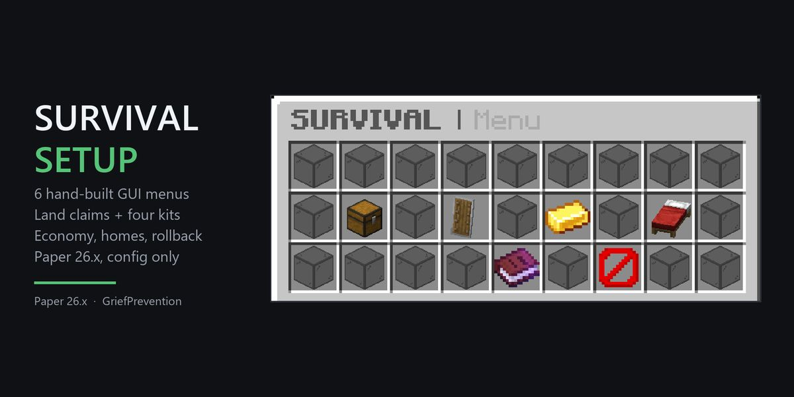
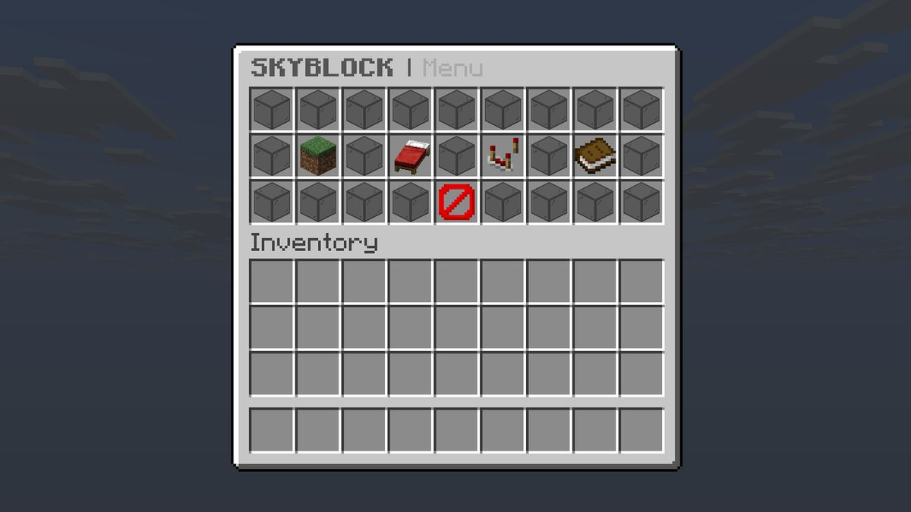
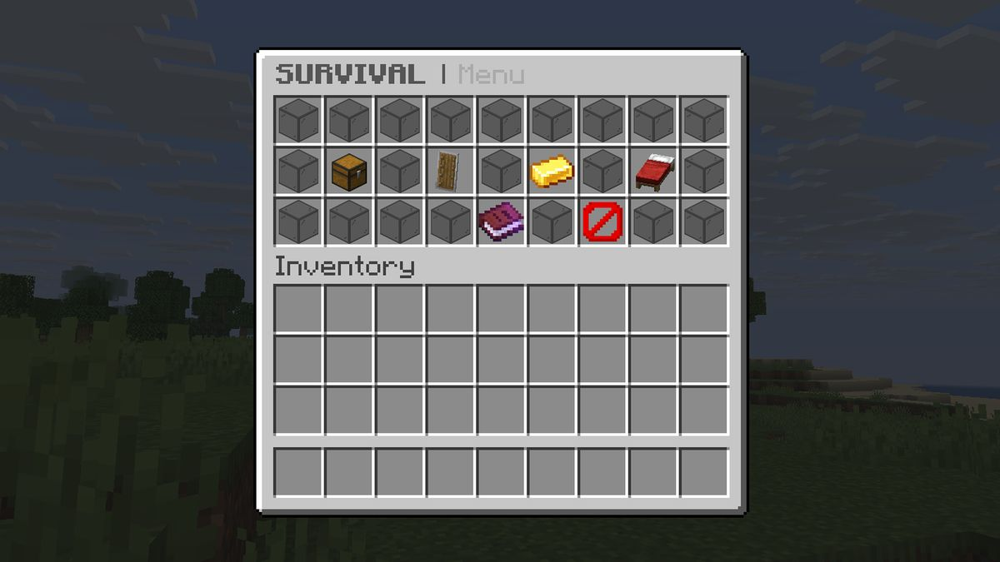
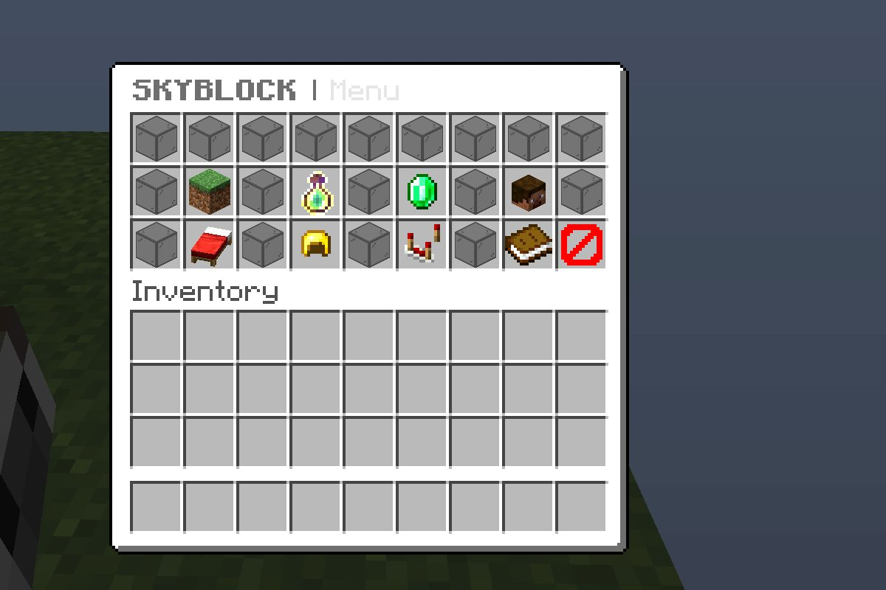
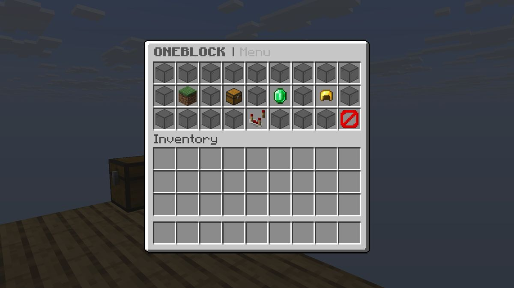
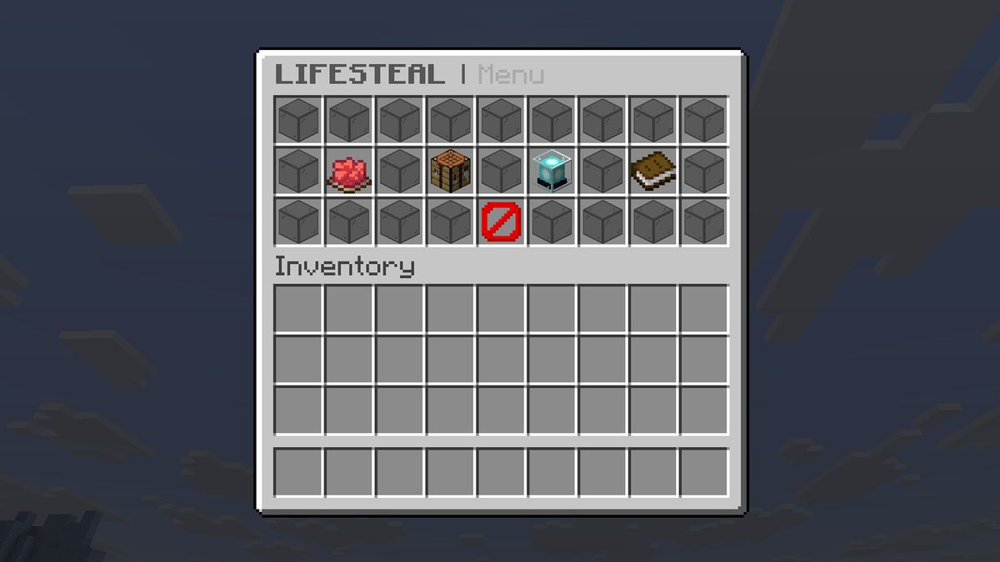

# Minecraft server setups that install themselves

Hand-written configuration packs for **Paper 26.x** servers — SkyBlock, OneBlock,
Lifesteal and Survival. Every pack ships a one-file installer that downloads Paper and
the exact plugin versions from each project's own release page, verifies every file
against a pinned SHA-256, and puts it in the right folder. If the machine has no
Java 25, the installer fetches a portable copy too.

No jar hunting. No "copy this file to plugins/…" table. No Java install by hand.

---

## Free — full source, no strings

### SkyBlock Menus Lite

Four DeluxeMenus GUIs for a BentoBox SkyBlock server, plus the same one-click
installer. Hub, island, info, and a reset-confirm guard.

Unzip → double-click `install.bat` → double-click `start.bat` → type `YES` once for
the EULA. That is the whole install.

**[Download the free pack](free/skyblock-menus-lite/)** · **[Starter Menus](free/starter-menus/)**

---

## Premium setups

### Survival Setup — $19.99

6 menus, 4 kits, GriefPrevention claims, EssentialsX economy, homes, CoreProtect
rollback, LuckPerms groups.

**[Buy on itch.io](https://asphero.itch.io/survival-setup-minecraft)**

### SkyBlock Setup — $12.99

Island levels, teams, protection, homes, sell shop, 9 hand-written GUIs, 5 permission
groups and tuned `bukkit.yml`.

**[Buy on itch.io](https://asphero.itch.io/skyblock-setup-minecraft)**

### OneBlock Setup — $19.99

AOneBlock phase progression, island levels and 5 hand-written GUIs.

**[Buy on itch.io](https://asphero.itch.io/oneblock-setup-minecraft)**

### Lifesteal SMP Setup — $19.99

Steal-heart PvP, revive beacons, heart withdrawal and 5 hand-written GUIs.

**[Buy on itch.io](https://asphero.itch.io/lifesteal-smp-setup-minecraft)**

Every paid pack includes the installer, the full server layout and the same
double-click setup as the free pack. The menu packs are written English | 中文 side by
side, so one purchase serves both your English and Chinese players.

---

## How the installer works

1. `install.bat` (or `run install.sh` on Linux / macOS) reads `installer/plugins.list`.
2. It downloads Paper and each plugin from that project's own release page.
3. Every download is checked against a pinned SHA-256. A truncated or swapped file is
   deleted and retried, never used.
4. Files land in their real server folders. Running it again is safe — files that
   already verify are skipped.
5. `start.bat` uses Aikar's flags, asks for the EULA once (`YES`), and starts the
   server. No Java on the machine? The installer already put a portable Temurin 25 in
   `runtime\`.

---

## Technical notes

Write-ups on problems that bit us, usually with a config snippet that fixes them.

- **[Why your SkyBlock server lags: `bukkit.yml` spawn limits are per world](docs/bukkit-spawn-limits.md)** —
  the single most common cause of a SkyBlock server that runs fine empty and dies at
  fifty players.

---

## Requirements

Everything here targets **Paper 26.x on Java 25**. Windows 10/11, or Linux / macOS
with bash and curl. 2 GB RAM minimum; 4 GB comfortable.

Third-party plugins remain under their own licenses; nothing here redistributes them.
Each pack's `LICENSE-THIRD-PARTY.md` lists the exact versions it builds against.

---

## License

**Free packs** — use them on any server you run, edit them however you like, and share
the link. You may not sell them, bundle them into a paid product, or redistribute them
as your own work. Full text in [LICENSE](LICENSE).

**Premium packs** — commercial license is granted with purchase. Not covered by the
license above.
